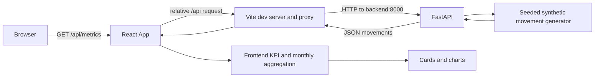

# Architecture and Data Flow

- **Last verified:** 2026-10-09
- **Evidence:** [`../frontend/src/App.tsx`](../frontend/src/App.tsx), [`../frontend/vite.config.ts`](../frontend/vite.config.ts), [`../backend/app/main.py`](../backend/app/main.py), [`../backend/app/routes.py`](../backend/app/routes.py), and [`../docker-compose.yml`](../docker-compose.yml).

## Runtime flow

## Responsibilities

- `frontend/src/App.tsx` loads `/api/metrics` once on mount and manages loading/error state.
- `frontend/src/lib/financial-utils.ts` computes KPI totals, monthly aggregates, and display formatting.
- `frontend/src/components/dashboard/` contains dashboard-specific presentation components; `src/components/ui/` contains shared UI primitives.
- `backend/app/main.py` constructs the FastAPI app, configures CORS, and registers the router.
- `backend/app/routes.py` contains Pydantic models, synthetic data generation, filtering/aggregation helpers, and the API endpoints.
- Vite proxies `/api` to `http://backend:8000` in the Compose development network.
- Docker Compose starts separate frontend and backend services.

The frontend currently consumes only `GET /api/metrics`. Other implemented backend endpoints are not wired into the current dashboard UI.

