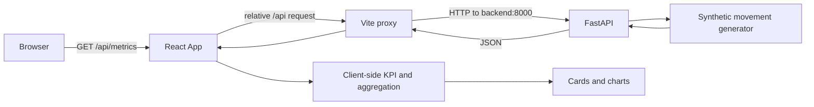

# Project Verification

- **Review date:** 2026-10-09
- **Revision/commit:** not recorded.
- **Scope:** product overview, stack, execution, architecture, data, endpoints, and repository evidence.
- **Method:** static inspection of source code, configuration, and existing tests.
- **Tests executed for this review:** none. Test references indicate that tests exist, not that they were run.

## 1. Product overview

This project is a demo financial metrics dashboard. It presents total income, expenses, net profit, and profit margin, alongside monthly income-vs-expense and margin charts.

The repository does not formally specify a target user persona. Based on the metrics, it might serve finance leads, business owners, or executives who need a summary view; this is an inference, not a documented requirement.

The frontend displays API data but does not provide file upload, movement editing, user filters, period selection, or export. It is not connected to real financial data.

## 2. Technology stack

| Layer | Technology | Evidence / declared version |
|---|---|---|
| Frontend | React, React DOM, TypeScript | `frontend/package.json`: React `^19.2.4`, TypeScript `~6.0.2` |
| Frontend server/build | Vite, React plugin | `frontend/package.json`: Vite `^8.0.4`; configuration in `frontend/vite.config.ts` |
| Styling | Tailwind CSS and Vite plugin | `frontend/package.json`: Tailwind `^4.2.2`, `@tailwindcss/vite` `^4.2.2` |
| Charts/icons | Recharts, Lucide React | `frontend/package.json`: Recharts `^3.8.1`, Lucide React `^1.8.0` |
| Backend/API | Python, FastAPI, Uvicorn | `python:3.13-slim` image; packages in `backend/requirements.txt`. FastAPI and Uvicorn versions are not pinned there. |
| Model validation | Pydantic | Models are defined in `backend/app/routes.py`; Pydantic is an indirect FastAPI dependency and is not listed directly in `requirements.txt`. |
| Containers | Docker and Docker Compose | `backend/Dockerfile`, `frontend/Dockerfile`, `docker-compose.yml` |
| Tests | pytest, Vitest | pytest in `backend/requirements.txt`; Vitest and npm scripts in `frontend/package.json` |

## 3. Frontend and backend

- **Frontend:** `frontend/src/App.tsx` fetches movements from `/api/metrics`, computes KPI and monthly aggregates through `frontend/src/lib/financial-utils.ts`, and renders dashboard cards/charts from `frontend/src/components/dashboard/`.
- **Backend:** `backend/app/main.py` creates the FastAPI app; `backend/app/routes.py` defines models, data generation, calculations, and HTTP routes. No persistence layer or database was found.

## 4. Architecture and communication



`frontend/src/App.tsx` uses `VITE_API_BASE_URL` when defined and a relative URL by default. `frontend/vite.config.ts` proxies `/api` to `http://backend:8000`, the backend service name in Compose. FastAPI configures wildcard origins, methods, and headers in `backend/app/main.py`.

The current frontend calls only `GET /api/metrics`. The additional aggregation and segment routes listed below are not wired into this UI.

## 5. Data and flow

- `generate_mock_movements(seed=42)` creates 360 synthetic movements, 30 for each calendar month, with income/outcome types, categories, and B2B/B2C segments.
- The seed makes random values reproducible. Dates are assigned to the twelve complete months before the current month, so the date range depends on when the backend runs.
- Data is generated in memory when routes are handled. No persistent storage, CSV/Excel import, or external financial data source was found.
- On initial load, the frontend fetches the movement list and computes KPI/chart aggregates in the client. The backend also calculates summaries, comparisons, alerts, and top categories, but the current UI does not consume those routes.
- The dashboard header uses the fixed label `2024 - Full Year` (`frontend/src/App.tsx`), although generated data dates depend on runtime date.

## 6. How to run

### Requirements

Docker and Docker Compose.

### Start

From the repository root:

```bash
docker compose up --build
```

### Local URLs

- Dashboard: <http://localhost:5173>
- API: <http://localhost:8000>
- FastAPI Swagger UI: <http://localhost:8000/docs>
- OpenAPI schema: <http://localhost:8000/openapi.json>

FastAPI automatically exposes Swagger UI and OpenAPI. The backend also starts Uvicorn with autoreload and debugpy on port 5678, as configured in `backend/Dockerfile`.

### Run tests (not executed for this review)

With the services running:

```bash
docker compose exec backend pytest
docker compose exec frontend npm test
```

These commands correspond to backend dependencies and the frontend `test` script in `frontend/package.json`.

## 7. Endpoint catalog

All endpoints below are defined in `backend/app/routes.py`. Verification status means the description was checked against the code; it does not mean the route was exercised at runtime. Test coverage refers to tests present in the repo, not tests run for this review.

| Method and route | Implemented behavior | Parameters | Used by frontend | Implementation status | Verification / test evidence |
|---|---|---|---|---|---|
| `GET /health` | Returns `{"status":"ok"}`. | None. | No | Implemented | Verified in code. Test: `test_health_endpoint_returns_ok`. |
| `GET /api/metrics` | Generates movements, applies optional filters, and returns records sorted by date. | `start_date`, `end_date`, `category`, `operation_type`. | Yes | Implemented | Verified in code. Tests cover dates, category, and operation. |
| `GET /api/metrics/facets` | Returns available operation types, business types, categories, and minimum/maximum dates. | None. | No | Implemented | Verified in code. Test: `test_metrics_facets_returns_filter_options_and_date_range`. |
| `GET /api/metrics/summary` | Groups movements by day, ISO week, or month and calculates income, outcome, and net per period. | `group_by` (`day`, `week`, `month`; default `month`), dates, category, operation, and `business_type`. | No | Implemented | Verified in code. Monthly and weekly summary tests exist. |
| `GET /api/metrics/categories/top` | Sums amounts by category for the selected operation type and returns the largest totals first. | `operation_type` (default `outcome`), `limit` (default 5, range 1-20), dates, and `business_type`. | No | Implemented | Verified in code. Test: `test_top_categories_returns_limited_sorted_categories`. |
| `GET /api/metrics/comparison` | Calculates net for the requested range and compares it with the immediately preceding interval of equal day count, inclusive of both ends. `delta_pct` is null if previous net is zero. | Required: `start_date`, `end_date`; optional: `business_type`. | No | Implemented | Verified in code. `test_metrics_comparison_returns_delta_fields` checks response keys, not the full calculation. |
| `GET /api/metrics/alerts` | Groups expenses and reports periods whose outcome strictly exceeds the threshold against the average of all prior periods in the filtered set. | `threshold` (default 0.3, minimum 0), `group_by` (default `month`), dates, and `business_type`. | No | Implemented | Verified in code. `test_metrics_alerts_returns_anomaly_candidates` checks shape when results exist. |
| `GET /api/metrics/b2b` | Filters B2B movements, applies common filters, and sorts by date. | Dates, category, and operation. | No | Implemented | B2B and combined-filter tests exist. |
| `GET /api/metrics/b2c` | Filters B2C movements, applies common filters, and sorts by date. | Dates, category, and operation. | No | Implemented | Test: `test_b2c_endpoint_only_returns_b2c_records`. |

## 8. Repository evidence

| Area | Primary evidence |
|---|---|
| FastAPI app and CORS | `backend/app/main.py` |
| Models, generator, and API endpoints | `backend/app/routes.py` |
| API tests | `backend/tests/test_routes.py` |
| Frontend entry and data fetch | `frontend/src/App.tsx` |
| Frontend data types | `frontend/src/lib/financial-types.ts` |
| KPI and monthly calculations | `frontend/src/lib/financial-utils.ts` |
| Frontend calculation tests | `frontend/src/lib/financial-utils.test.ts` |
| Vite proxy | `frontend/vite.config.ts` |
| Frontend dependencies | `frontend/package.json` |
| Backend dependencies | `backend/requirements.txt` |
| Containers and ports | `docker-compose.yml`, `frontend/Dockerfile`, `backend/Dockerfile` |
| Contributor instructions | `README.md`, `README.es.md`, `AGENTS.md` |

## 9. Findings and limitations

- **Demo data:** metrics are not based on real records and are not persisted; the generator is in `backend/app/routes.py`.
- **Partial UI coverage:** the UI consumes only `/api/metrics`; other backend routes are implemented but not exposed as dashboard interactions.
- **Static period label:** the UI displays `2024 - Full Year` while generated dates depend on runtime date.
- **No data ingestion:** no file upload, movement form, or financial-system integration was found.
- **Permissive CORS:** `backend/app/main.py` allows wildcard origins, methods, and headers; review before exposing outside development.
- **Execution not checked for this review:** tests exist but were not run; no claim is made that they pass or that containers were started.
