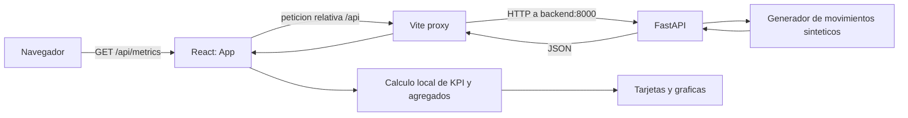

# Verificacion del proyecto

- **Fecha de revision:** 2026-10-09
- **Revision/commit:** no registrado en este documento.
- **Alcance:** overview funcional, stack, ejecucion, arquitectura, datos, endpoints y evidencia localizada en el repositorio.
- **Metodo:** inspeccion estatica de codigo, configuracion y tests existentes.
- **Tests ejecutados durante esta revision:** ninguno. Las referencias a tests indican que existen, no que hayan sido ejecutados.

## 1. Overview funcional del producto

El proyecto es un dashboard de metricas financieras de demostracion. Presenta ingresos, gastos, beneficio neto y margen de beneficio, junto con graficas mensuales de ingresos frente a gastos y evolucion del margen.

El perfil de usuario no esta formalmente especificado en el repositorio. Por el tipo de indicadores, podria servir a responsables financieros, propietarios de negocios o perfiles ejecutivos que necesiten una vista resumida; esto es una inferencia, no un requisito documentado.

El frontend muestra los datos recibidos de la API, pero no ofrece carga de archivos, edicion de movimientos, filtros de usuario, seleccion de periodo ni exportacion. No es un sistema conectado a datos financieros reales.

## 2. Stack tecnologico hallado

| Capa | Tecnologia | Evidencia / version declarada |
|---|---|---|
| Frontend | React, React DOM, TypeScript | `frontend/package.json`: React `^19.2.4`, TypeScript `~6.0.2` |
| Servidor y build frontend | Vite, plugin React | `frontend/package.json`: Vite `^8.0.4`; configuracion en `frontend/vite.config.ts` |
| Estilos | Tailwind CSS y plugin Vite | `frontend/package.json`: Tailwind `^4.2.2`, `@tailwindcss/vite` `^4.2.2` |
| Graficas e iconos | Recharts, Lucide React | `frontend/package.json`: Recharts `^3.8.1`, Lucide React `^1.8.0` |
| Backend/API | Python, FastAPI, Uvicorn | Imagen `python:3.13-slim`; paquetes en `backend/requirements.txt`. FastAPI y Uvicorn no tienen version fijada ahi. |
| Validacion de modelos | Pydantic | Los modelos estan definidos en `backend/app/routes.py`; llega como dependencia de FastAPI y no aparece listado directamente en `requirements.txt`. |
| Contenedores | Docker y Docker Compose | `backend/Dockerfile`, `frontend/Dockerfile`, `docker-compose.yml` |
| Tests | pytest, Vitest | pytest en `backend/requirements.txt`; Vitest y comandos npm en `frontend/package.json` |

## 3. Frontend y backend

- **Frontend:** `frontend/src/App.tsx` obtiene los movimientos de `/api/metrics`, calcula localmente KPI y agregados mensuales mediante `frontend/src/lib/financial-utils.ts`, y renderiza tarjetas y graficas con componentes en `frontend/src/components/dashboard/`.
- **Backend:** `backend/app/main.py` crea la aplicacion FastAPI; `backend/app/routes.py` define modelos, generacion de datos, calculos y rutas HTTP. No se encontro capa de persistencia ni base de datos.

## 4. Arquitectura y comunicacion



`frontend/src/App.tsx` usa `VITE_API_BASE_URL` si esta definida; por defecto usa una ruta relativa. `frontend/vite.config.ts` reenvia `/api` a `http://backend:8000`, el nombre del servicio backend en Compose. FastAPI configura CORS con origenes, metodos y headers comodin en `backend/app/main.py`.

El frontend actual solo consulta `GET /api/metrics`. Los endpoints agregados y de segmentacion documentados mas abajo no estan conectados a esta interfaz.

## 5. Datos y flujo

- `generate_mock_movements(seed=42)` crea 360 movimientos sinteticos, 30 por cada mes del calendario, con tipos de operacion income/outcome, categorias y segmentos B2B/B2C.
- La semilla hace reproducibles los valores aleatorios. Las fechas se asignan a los doce meses completos anteriores al mes actual; por tanto, el rango de fechas depende de cuando se ejecuta el backend.
- Los datos se generan en memoria al atender las rutas. No se encontro almacenamiento persistente, importacion de CSV/Excel ni conexion a una fuente financiera externa.
- En cada carga inicial, el frontend solicita la lista y calcula los KPI y agregados en el cliente. Las rutas de resumen, comparacion, alertas y categorias top se calculan en backend, pero no las consume la UI actual.
- El encabezado del dashboard usa la etiqueta fija `2024 - Full Year` (`frontend/src/App.tsx`), aunque las fechas de los datos generados dependen de la fecha de ejecucion.

## 6. Como ejecutar

### Requisitos

Docker con Docker Compose disponible.

### Arrancar

Desde la raiz del repositorio:

```bash
docker compose up --build
```

### URLs locales

- Dashboard: <http://localhost:5173>
- API: <http://localhost:8000>
- Swagger UI de FastAPI: <http://localhost:8000/docs>
- Esquema OpenAPI: <http://localhost:8000/openapi.json>

FastAPI expone Swagger UI y OpenAPI automaticamente. El backend tambien arranca Uvicorn con autoreload y debugpy en el puerto 5678, segun `backend/Dockerfile`.

### Ejecutar tests (no ejecutados en esta revision)

Con los servicios levantados:

```bash
docker compose exec backend pytest
docker compose exec frontend npm test
```

Los comandos corresponden a las dependencias del backend y al script `test` de `frontend/package.json`.

## 7. Catalogo de endpoints

Todos los endpoints siguientes estan declarados en `backend/app/routes.py`. El estado de verificacion califica la coincidencia entre la descripcion y el codigo inspeccionado; no afirma que se hayan probado en ejecucion. La cobertura indicada identifica tests existentes, no ejecutados durante esta revision.

| Metodo y ruta | Comportamiento implementado | Parametros | Consumido por frontend | Estado de implementacion | Verificacion / evidencia de test |
|---|---|---|---|---|---|
| `GET /health` | Devuelve `{"status":"ok"}`. | Ninguno. | No | Implementado | Verificado en codigo. Test: `test_health_endpoint_returns_ok`. |
| `GET /api/metrics` | Genera movimientos, aplica filtros opcionales y devuelve la lista ordenada por fecha. | `start_date`, `end_date`, `category`, `operation_type`. | Si | Implementado | Verificado en codigo. Tests de fechas, categoria y operacion. |
| `GET /api/metrics/facets` | Devuelve tipos de operacion, tipos de negocio, categorias y fechas minima/maxima de los movimientos generados. | Ninguno. | No | Implementado | Verificado en codigo. Test: `test_metrics_facets_returns_filter_options_and_date_range`. |
| `GET /api/metrics/summary` | Agrupa por dia, semana ISO o mes y calcula ingresos, gastos y neto por periodo. | `group_by` (`day`, `week`, `month`; default `month`), fechas, categoria, operacion y `business_type`. | No | Implementado | Verificado en codigo. Tests de resumen mensual y semanal. |
| `GET /api/metrics/categories/top` | Suma importes por categoria para el tipo de operacion seleccionado y devuelve los mayores primero. | `operation_type` (default `outcome`), `limit` (default 5, entre 1 y 20), fechas y `business_type`. | No | Implementado | Verificado en codigo. Test: `test_top_categories_returns_limited_sorted_categories`. |
| `GET /api/metrics/comparison` | Calcula el neto del rango requerido y lo compara con el intervalo contiguo anterior de igual numero de dias, contando ambos extremos. `delta_pct` es null si el neto anterior es cero. | Requeridos: `start_date`, `end_date`; opcional: `business_type`. | No | Implementado | Verificado en codigo. Test `test_metrics_comparison_returns_delta_fields` verifica las claves de respuesta, no toda la formula. |
| `GET /api/metrics/alerts` | Agrupa gastos y marca periodos cuyo gasto supera estrictamente el umbral respecto al promedio de todos los periodos anteriores del conjunto filtrado. | `threshold` (default 0.3, minimo 0), `group_by` (default `month`), fechas y `business_type`. | No | Implementado | Verificado en codigo. Test: `test_metrics_alerts_returns_anomaly_candidates`; valida la forma si hay resultados. |
| `GET /api/metrics/b2b` | Filtra movimientos B2B, aplica filtros comunes y ordena por fecha. | Fechas, categoria y operacion. | No | Implementado | Verificado en codigo. Tests de B2B y combinacion de filtros. |
| `GET /api/metrics/b2c` | Filtra movimientos B2C, aplica filtros comunes y ordena por fecha. | Fechas, categoria y operacion. | No | Implementado | Verificado en codigo. Test: `test_b2c_endpoint_only_returns_b2c_records`. |

## 8. Evidencias en el repositorio

| Area | Evidencia principal |
|---|---|
| Aplicacion FastAPI y CORS | `backend/app/main.py` |
| Modelos, generador y endpoints API | `backend/app/routes.py` |
| Pruebas API | `backend/tests/test_routes.py` |
| Arranque y fetch de datos frontend | `frontend/src/App.tsx` |
| Tipos de datos frontend | `frontend/src/lib/financial-types.ts` |
| Calculos KPI y mensuales | `frontend/src/lib/financial-utils.ts` |
| Tests de calculos frontend | `frontend/src/lib/financial-utils.test.ts` |
| Proxy de Vite | `frontend/vite.config.ts` |
| Dependencias frontend | `frontend/package.json` |
| Dependencias backend | `backend/requirements.txt` |
| Contenedores y puertos | `docker-compose.yml`, `frontend/Dockerfile`, `backend/Dockerfile` |
| Instrucciones del proyecto | `README.md`, `README.es.md` |

## 9. Hallazgos y limites

- **Datos demostrativos:** las metricas no proceden de datos reales ni persisten entre peticiones; el generador esta en `backend/app/routes.py`.
- **Cobertura de la interfaz:** la UI consume solo `/api/metrics`; las rutas adicionales estan implementadas en backend, pero no expuestas como interacciones del dashboard.
- **Periodo de cabecera estatico:** se muestra `2024 - Full Year` mientras que el generador usa fechas relativas a la fecha de ejecucion.
- **Sin ingestion de datos:** no se encontro carga de archivos, formulario de movimientos ni integracion con sistemas financieros.
- **CORS permisivo:** `backend/app/main.py` permite origenes, metodos y headers comodin; revisar esta configuracion antes de exponer el servicio fuera del entorno de desarrollo.
- **Ejecucion no comprobada en esta revision:** los tests existen, pero no se corrieron; no se afirma aqui que pasen ni que los contenedores se hayan levantado.
